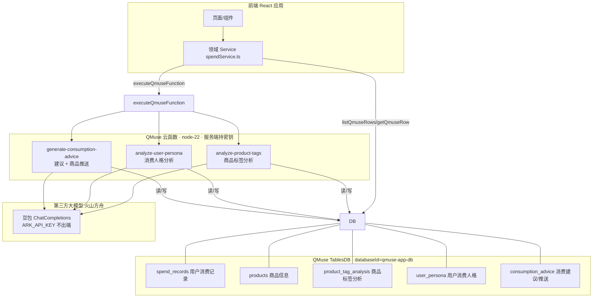

# QMuse 消费人格洞察 · 后端框架设计

> 状态：**设计稿（可落地）**。本文给出后端数据表、云函数、大模型 Prompt 与规范 JSON 契约的完整设计。
> 当前执行环境的 `qmuse-cli` 未安装，无法在线初始化/建表/注入密钥/导入，因此**未执行实际云资源创建**；
> 本文所有声明均基于 QMuse 云服务技术契约，可在具备 `qmuse-cli` 的环境按文末"落地步骤"一键应用。

---

## 0. 结论：QMuse 能否免费接入大模型

**结论：QMuse 云服务本身不内置"免费大模型"给你直接调用；但云函数可以在服务端通过密钥调用第三方大模型（推荐火山方舟豆包/DeepSeek），浏览器不持有密钥。"免费"仅体现在第三方平台的免费额度，不是 QMuse 平台赠送。**

依据与要点：

1. QMuse 云服务是基于私有化 Appwrite 后端的云能力（数据表/文件/云函数）。技术契约第 12 节明确：AI 应用"只有第三方模型及其凭证已有明确依据时，才通过 QMuse 密钥管理把模型 API Key 交给云函数；浏览器不持有密钥"。即：**云函数可调用外部大模型，但那是带密钥的第三方服务**。
2. 豆包大模型（火山方舟 ARK）是独立计费的第三方服务：需先在方舟控制台开通语言模型、创建 API Key；平台对新模型有免费 Tokens 额度（例如"首次开通语言模型，每个模型立享 50 万免费 Tokens"、部分模型"限时免费 100 次/天"等），属于**限量的免费额度**，超出后按量计费，并非无限免费。
3. 接入路径固定为：云函数声明 `functions` + `qmuse-cli cloud set-secret "ARK_API_KEY"` 注入密钥 → 函数内 `process.env.ARK_API_KEY` 调用方舟 OpenAI 兼容接口（`https://ark.cn-beijing.volces.com/api/v3`）。

**本设计的假设**：使用火山方舟豆包大模型，密钥 `ARK_API_KEY`。若改用其它模型商，仅需更换密钥名与 base_url，数据表/云函数/Prompt/JSON 契约不变。

---

## 1. 总体架构与数据流



### 核心业务流

- **记账**：前端把一笔消费写入 `spend_records`（用户↔记录对应关系通过行 `creatorId` owner ACL 表达，另设 `user_ref` 供云函数跨用户聚合）。
- **商品标签分析**：新增商品 → 调用 `analyze-product-tags`，云函数读 `products`、调大模型生成细分标签/场景/总结/人格，写入 `product_tag_analysis` 并把标签与 `tag_analysis_id` 回填到 `products`。
- **消费人格分析**：调用 `analyze-user-persona`，云函数聚合该用户 `spend_records` → 调大模型 → 写入 `user_persona`（按月/年，唯一键 upsert）。
- **消费建议 + 商品推送**：调用 `generate-consumption-advice`，云函数读 `spend_records` + `user_persona` → 调大模型，大模型返回建议文案 + `recommended_product_ids` → 云函数 JOIN `products` 表取商品详情 → 写入 `consumption_advice` → 把 `{ advice, products }` 返回前端展示。

---

## 2. 数据表设计（`.appwrite_schema.json`）

> 契约要点：`databaseId` 固定 `qmuse-app-db`；内联列 `type` 仅 `string / integer / double / boolean / datetime`；`string` 必须给 `size`；`enum` 用 `format:"enum"`+`elements`；不声明 `code/creatorId/modifierId/$ 开头` 字段；索引仅 `key/unique/fulltext`；列 `format` 仅 `email/enum/ip/url`。
> 行级 owner ACL 由平台默认（READ:ALL / SUBMIT:ALL / EDIT:CREATOR / DELETE:CREATOR）自动写入 `creatorId`，业务列不重复声明。

```json
{
  "databaseId": "qmuse-app-db",
  "projectAlias": "default",
  "tables": [
    {
      "tableId": "spend_records",
      "name": "用户消费记录",
      "comment": "用户与购买记录id的对应关系：以 owner(creatorId) 表达归属，user_ref 供云函数显式聚合",
      "columns": [
        { "key": "amount", "type": "double", "comment": "消费金额", "required": true },
        { "key": "spend_date", "type": "datetime", "comment": "消费时间", "required": true },
        { "key": "category", "type": "string", "format": "enum", "elements": ["玩具","食品","服饰","数码","家居","健康","图书","宠物","户外","娱乐","美妆","母婴"], "size": 64, "comment": "宽泛类型", "required": true },
        { "key": "tags", "type": "string", "size": 2000, "comment": "细分标签JSON数组,如[\"手办\",\"动漫周边\"]", "required": false },
        { "key": "product_id", "type": "string", "size": 128, "comment": "关联商品信息表", "required": false },
        { "key": "merchant", "type": "string", "size": 255, "comment": "商家/渠道", "required": false },
        { "key": "note", "type": "string", "size": 1000, "comment": "备注", "required": false },
        { "key": "user_ref", "type": "string", "size": 128, "comment": "显式用户标识(云函数服务端写入,不做浏览器鉴权依据)", "required": false }
      ],
      "indexes": [
        { "key": "idx_spend_date", "type": "key", "attributes": ["spend_date"] },
        { "key": "idx_category", "type": "key", "attributes": ["category"] },
        { "key": "idx_product", "type": "key", "attributes": ["product_id"] }
      ]
    },
    {
      "tableId": "products",
      "name": "商品信息",
      "comment": "购买商品基础信息 + 商品分析标签id",
      "columns": [
        { "key": "name", "type": "string", "size": 255, "comment": "商品名", "required": true },
        { "key": "category", "type": "string", "format": "enum", "elements": ["玩具","食品","服饰","数码","家居","健康","图书","宠物","户外","娱乐","美妆","母婴"], "size": 64, "comment": "宽泛类型", "required": true },
        { "key": "price", "type": "double", "comment": "参考价", "required": false },
        { "key": "merchant", "type": "string", "size": 255, "comment": "商家/来源", "required": false },
        { "key": "desc", "type": "string", "size": 2000, "comment": "商品描述", "required": false },
        { "key": "tags", "type": "string", "size": 2000, "comment": "标签分析回填的细分标签JSON数组", "required": false },
        { "key": "persona_ids", "type": "string", "size": 2000, "comment": "标签分析回填的关联人格JSON数组", "required": false },
        { "key": "tag_analysis_id", "type": "string", "size": 128, "comment": "商品分析标签id(关联 product_tag_analysis)", "required": false },
        { "key": "image_ref", "type": "string", "size": 512, "comment": "图片文件引用ID或URL", "required": false }
      ],
      "indexes": [
        { "key": "idx_category", "type": "key", "attributes": ["category"] },
        { "key": "idx_tag_analysis", "type": "key", "attributes": ["tag_analysis_id"] }
      ]
    },
    {
      "tableId": "product_tag_analysis",
      "name": "商品标签分析",
      "comment": "大模型对商品的细分标签/场景/总结/人格推断,由云函数写入",
      "columns": [
        { "key": "product_id", "type": "string", "size": 128, "comment": "关联商品", "required": true },
        { "key": "tags_json", "type": "string", "size": 4000, "comment": "细分标签JSON数组", "required": false },
        { "key": "persona_ids_json", "type": "string", "size": 2000, "comment": "关联人格JSON数组", "required": false },
        { "key": "scene", "type": "string", "size": 500, "comment": "暗含消费场景", "required": false },
        { "key": "summary", "type": "string", "size": 2000, "comment": "大模型总结", "required": false },
        { "key": "raw_json", "type": "string", "size": 8000, "comment": "大模型原始返回", "required": false },
        { "key": "model", "type": "string", "size": 128, "comment": "所用模型", "required": false },
        { "key": "prompt_version", "type": "string", "size": 64, "comment": "Prompt版本", "required": false },
        { "key": "status", "type": "string", "format": "enum", "elements": ["pending","done","failed"], "size": 16, "comment": "分析状态", "required": true }
      ],
      "indexes": [
        { "key": "idx_product", "type": "key", "attributes": ["product_id"] }
      ]
    },
    {
      "tableId": "user_persona",
      "name": "用户消费人格",
      "comment": "大模型按周期推断的用户消费人格,按(用户,周期类型,周期)唯一",
      "columns": [
        { "key": "user_ref", "type": "string", "size": 128, "comment": "用户标识", "required": true },
        { "key": "period_type", "type": "string", "format": "enum", "elements": ["month","year"], "size": 16, "comment": "周期类型", "required": true },
        { "key": "period_key", "type": "string", "size": 64, "comment": "周期键,如2026-10或2026", "required": true },
        { "key": "dominant_id", "type": "string", "size": 64, "comment": "主人格id", "required": false },
        { "key": "secondary_id", "type": "string", "size": 64, "comment": "次人格id", "required": false },
        { "key": "scores_json", "type": "string", "size": 4000, "comment": "各人格得分JSON", "required": false },
        { "key": "profile", "type": "string", "size": 4000, "comment": "人格画像描述", "required": false },
        { "key": "interests_json", "type": "string", "size": 2000, "comment": "兴趣偏好JSON数组", "required": false },
        { "key": "cycle_json", "type": "string", "size": 4000, "comment": "周期习惯JSON", "required": false },
        { "key": "raw_json", "type": "string", "size": 8000, "comment": "大模型原始返回", "required": false },
        { "key": "model", "type": "string", "size": 128, "comment": "所用模型", "required": false },
        { "key": "status", "type": "string", "format": "enum", "elements": ["pending","done","failed"], "size": 16, "comment": "状态", "required": true }
      ],
      "indexes": [
        { "key": "uq_user_period", "type": "unique", "attributes": ["user_ref", "period_type", "period_key"] }
      ]
    },
    {
      "tableId": "consumption_advice",
      "name": "消费建议与商品推送",
      "comment": "大模型给出的省钱/爱好建议 + 推荐商品id,云函数JOIN商品表后回传前端",
      "columns": [
        { "key": "user_ref", "type": "string", "size": 128, "comment": "用户标识", "required": true },
        { "key": "advice_type", "type": "string", "format": "enum", "elements": ["save","hobby"], "size": 16, "comment": "建议类型", "required": true },
        { "key": "period_key", "type": "string", "size": 64, "comment": "周期键", "required": true },
        { "key": "title", "type": "string", "size": 255, "comment": "建议标题", "required": false },
        { "key": "summary", "type": "string", "size": 2000, "comment": "建议概述", "required": false },
        { "key": "points_json", "type": "string", "size": 4000, "comment": "建议要点JSON数组", "required": false },
        { "key": "product_ids_json", "type": "string", "size": 2000, "comment": "大模型给出的推荐商品idJSON数组", "required": false },
        { "key": "matched_persona_id", "type": "string", "size": 64, "comment": "命中人格id", "required": false },
        { "key": "raw_json", "type": "string", "size": 8000, "comment": "大模型原始返回", "required": false },
        { "key": "status", "type": "string", "format": "enum", "elements": ["pending","done","failed"], "size": 16, "comment": "状态", "required": true }
      ],
      "indexes": [
        { "key": "uq_user_type_period", "type": "unique", "attributes": ["user_ref", "advice_type", "period_key"] }
      ]
    }
  ],
  "functions": [
    {
      "functionId": "analyze-product-tags",
      "name": "商品标签分析",
      "runtime": "node-22",
      "entrypoint": "src/main.js",
      "commands": "npm install",
      "timeout": 60,
      "enabled": true,
      "execute": ["users"],
      "scopes": ["databases.read", "databases.write", "rows.read", "rows.write"],
      "path": "functions/analyze-product-tags"
    },
    {
      "functionId": "analyze-user-persona",
      "name": "用户消费人格分析",
      "runtime": "node-22",
      "entrypoint": "src/main.js",
      "commands": "npm install",
      "timeout": 60,
      "enabled": true,
      "execute": ["users"],
      "scopes": ["databases.read", "databases.write", "rows.read", "rows.write"],
      "path": "functions/analyze-user-persona"
    },
    {
      "functionId": "generate-consumption-advice",
      "name": "消费建议与商品推送",
      "runtime": "node-22",
      "entrypoint": "src/main.js",
      "commands": "npm install",
      "timeout": 90,
      "enabled": true,
      "execute": ["users"],
      "scopes": ["databases.read", "databases.write", "rows.read", "rows.write"],
      "path": "functions/generate-consumption-advice"
    }
  ]
}
```

> 说明：
> - 三张分析类表 `status` 用枚举 `pending/done/failed` 承载异步/失败状态，前端据此展示"分析中/完成/失败"。
> - `*_json` 列统一存 JSON 字符串（TablesDB 不声明 `array` 扩展属性），云函数负责序列化/反序列化，保证类型安全。
> - 商品推送的"大模型给商品id → 查商品表 → 展示前端"闭环在 `generate-consumption-advice` 中完成，前端只拿最终商品详情。

---

## 3. 云函数设计

三个云函数均为**浏览器主动调用**（`execute: ["users"]`），服务端持密钥调大模型。函数目录：

```
functions/
├── analyze-product-tags/src/main.js        + package.json
├── analyze-user-persona/src/main.js        + package.json
└── generate-consumption-advice/src/main.js + package.json
```

`package.json` 统一为 ESM，依赖 `node-appwrite`（需访问 Appwrite 服务端 API）：

```json
{
  "name": "analyze-product-tags",
  "type": "module",
  "main": "src/main.js",
  "dependencies": { "node-appwrite": "^23.0.0" }
}
```

### 3.1 运行时骨架（三个函数共用模式）

```js
// functions/<id>/src/main.js
import { Client, TablesDB } from "node-appwrite";
import { ARK_BASE_URL, chatCompletion } from "./llm.js"; // 见 3.5

export default async ({ req, res, log, error }) => {
  const body = req.bodyJson ?? {};
  try {
    const client = new Client()
      .setEndpoint(process.env.APPWRITE_FUNCTION_API_ENDPOINT)
      .setProject(process.env.APPWRITE_FUNCTION_PROJECT_ID)
      .setKey(req.headers["x-appwrite-key"]);
    const databaseId = process.env.QMUSE_APPWRITE_DATABASE_ID;
    if (!databaseId) throw new Error("QMuse Appwrite database ID is missing");
    const tablesDB = new TablesDB(client);

    // ... 各函数业务逻辑
  } catch (cause) {
    error(cause instanceof Error ? cause.message : String(cause));
    return res.json({ success: false, message: "Function failed" }, 500);
  }
};
```

### 3.2 `analyze-product-tags` — 商品标签分析

- **输入** `{ productId: string }`
- **步骤**：
  1. `getRow(products, productId)` 取商品（name/category/desc/price/merchant）。
  2. 组装 Prompt（见 §4.1），调大模型 → 解析 JSON。
  3. 写入 `product_tag_analysis`（`status:"done"`、`tags_json/persona_ids_json/scene/summary/raw_json/model/prompt_version`）。
  4. 更新 `products`：回填 `tags`、`persona_ids`、`tag_analysis_id`。
- **返回** `{ success:true, data: { tag_analysis_id, tags, persona_ids, scene, summary } }`

### 3.3 `analyze-user-persona` — 消费人格分析

- **输入** `{ periodType: "month"|"year", periodKey: "2026-10"|"2026" }`
- **步骤**：
  1. 按 `x-appwrite-user-jwt` 解析当前用户 `user_ref`（服务端可信身份；不接收浏览器传入的 userId）。
  2. `listRows(spend_records, 按 user_ref + 周期过滤)` 聚合金额/分类/标签/星期分布。
  3. 调大模型（Prompt §4.2）→ 解析 JSON。
  4. 按唯一键 `(user_ref, period_type, period_key)` upsert 到 `user_persona`。
- **返回** `{ success:true, data: { dominant_id, secondary_id, scores, profile, interests, cycle_habits } }`

### 3.4 `generate-consumption-advice` — 消费建议 + 商品推送

- **输入** `{ adviceType: "save"|"hobby", periodKey: "2026-10" }`
- **步骤**：
  1. 解析用户 `user_ref`；读 `spend_records` 聚合 + 读/算 `user_persona`（period=periodKey）。
  2. `listRows(products, limit 50)` 取商品目录（id/name/category/tags/persona_ids）作为候选池。
  3. 调大模型（Prompt §4.3）→ 大模型返回建议 + `recommended_product_ids`。
  4. 用 `recommended_product_ids` JOIN `products`，取商品详情。
  5. 按唯一键 `(user_ref, advice_type, period_key)` upsert 到 `consumption_advice`。
- **返回** `{ success:true, data: { advice: {title,summary,points,saving_estimate}, products: [...] } }` —— 前端直接渲染 `products` 卡片。

### 3.5 大模型调用封装 `functions/<id>/src/llm.js`

```js
// 常量内联在函数源码（不含密钥）
export const ARK_BASE_URL = "https://ark.cn-beijing.volces.com/api/v3";

// 统一 ChatCompletions 调用，要求 JSON 输出，自动剥离代码围栏
export async function chatCompletion({ apiKey, model, system, user }) {
  const resp = await fetch(`${ARK_BASE_URL}/chat/completions`, {
    method: "POST",
    headers: {
      "Content-Type": "application/json",
      Authorization: `Bearer ${apiKey}`,
    },
    body: JSON.stringify({
      model,
      messages: [
        { role: "system", content: system },
        { role: "user", content: user },
      ],
      temperature: 0.3,
      response_format: { type: "json_object" },
    }),
  });
  if (!resp.ok) {
    const text = await resp.text();
    throw new Error(`LLM ${resp.status}: ${text.slice(0, 200)}`);
  }
  const data = await resp.json();
  const content = data?.choices?.[0]?.message?.content ?? "";
  return JSON.parse(content.replace(/^```json|```$/g, "").trim());
}
```

> 密钥在函数内通过字面量读取：`const apiKey = process.env.ARK_API_KEY;`（密钥名与 `set-secret` 完全一致，禁止别名/解构/动态访问）。

---

## 4. 大模型 Prompt 与规范 JSON 契约

三套 Prompt 均要求模型**只输出合法 JSON**（`response_format: json_object` + 温度 0.3），云函数解析后落库、回传前端。前端拿到的是清洗后的领域 JSON，不直接面对模型原文。

### 4.1 商品标签分析 `analyze-product-tags`

**System（固定）**：

```text
你是电商消费场景分析师。你根据商品的名称、分类、描述与价格，推断该商品"暗含的消费场景"并打上细分标签，关联到固定的消费人格。只输出 JSON，不要输出任何解释或 Markdown 围栏。

人格白名单(固定): anime二次元, family家庭生活, fashion时尚穿搭, health健康养生, digital数码科技, food美食餐饮, reading文化阅读, pet宠物生活, outdoor户外运动, gaming游戏娱乐, beauty美妆护肤。

标签示例: 动漫周边、手办、谷子、可爱毛绒玩具、亲子、厨具、球鞋、潮牌、蛋白粉、瑜伽、咖啡、外卖、露营、宠物玩具、游戏皮肤 等。标签要具体、可归因到消费场景，数量 3~6 个。
```

**User**：

```text
商品信息(JSON):
{product}

请输出如下 JSON（字段与枚举必须严格匹配，persona_ids 只能取白名单内 id，1~3 个，按相关度排序）：
{
  "tags": ["string"],
  "scene": "一句话描述该商品的暗含消费场景",
  "summary": "两到三句话总结该商品满足的用户需求与消费动机",
  "persona_ids": ["string"]
}
```

**输出契约（落库到 product_tag_analysis + 回填 products）**：

```json
{
  "tags": ["动漫周边", "手办", "收藏"],
  "scene": "二次元动漫周边收藏与悦己消费场景",
  "summary": "用户为喜爱的动漫IP付费，注重收藏价值与情绪满足，属于情感驱动的悦己型消费。",
  "persona_ids": ["anime"]
}
```

### 4.2 用户消费人格 `analyze-user-persona`

**System（固定）**：

```text
你是消费行为与用户画像分析师。根据用户一个周期内的消费记录聚合，推断其消费人格、兴趣偏好与消费周期习惯。只输出 JSON。

人格白名单(固定): anime二次元, family家庭生活, fashion时尚穿搭, health健康养生, digital数码科技, food美食餐饮, reading文化阅读, pet宠物生活, outdoor户外运动, gaming游戏娱乐, beauty美妆护肤。

周期习惯类型(固定): weekday周内节奏, subscription订阅固定支出, monthBand上中下旬集中, impulse大额悦己/冲动。
```

**User**：

```text
周期类型: {periodType} ({periodKey})
用户消费聚合(JSON):
{aggregation}

aggregation 结构示例:
{
  "total": 2844.74, "count": 31, "avg": 91.77,
  "categories": [{"name":"玩具","total":875.97,"count":8}],
  "tags": [{"name":"动漫周边","total":875.97,"count":7}],
  "weekday": {"工作日":0.40,"周末":0.60},
  "monthBand": {"上旬":0.2,"中旬":0.62,"下旬":0.18}
}

请输出如下 JSON：
{
  "dominant_id": "string(白名单id)",
  "secondary_id": "string(白名单id)",
  "scores": [{"persona_id":"string","share":0}],
  "profile": "两到三句人格画像描述",
  "interests": ["string"],
  "cycle_habits": [{"type":"string(周期类型)","title":"string","detail":"string","insight":"string"}]
}
```

**输出契约（落库到 user_persona）**：

```json
{
  "dominant_id": "anime",
  "secondary_id": "health",
  "scores": [
    { "persona_id": "anime", "share": 33 },
    { "persona_id": "health", "share": 12 }
  ],
  "profile": "为热爱买单的二次元型消费者，同时对健康管理持续投入，具备悦己与自我提升的双重画像。",
  "interests": ["手办", "健身", "收藏", "动漫周边"],
  "cycle_habits": [
    { "type": "weekday", "title": "周末悦己型", "detail": "周末消费占比60%", "insight": "建议周末前做好预算" },
    { "type": "subscription", "title": "订阅固定支出", "detail": "月固定订阅约¥180", "insight": "按季度清理低频订阅" }
  ]
}
```

### 4.3 消费建议 + 商品推送 `generate-consumption-advice`

**System（固定）**：

```text
你是消费理财与商品推荐专家。根据用户消费人格、周期聚合与商品目录，给出可落地的消费建议，并推荐与人格/建议契合的商品。只输出 JSON。
商品推荐必须是"用户可能真正购买、与人格契合"的候选，从给定的商品目录中选择 id。
```

**User**：

```text
建议类型: {adviceType}（save=省钱建议 / hobby=爱好培养建议）
用户人格: {personaJson}
周期聚合: {aggregationJson}
商品目录(JSON数组，每项含 id/name/category/tags/persona_ids):
{catalog}

请输出如下 JSON：
{
  "advice": {
    "title": "string",
    "summary": "两到三句话",
    "points": ["string", "string"],
    "saving_estimate": 0
  },
  "recommended_product_ids": ["string"]
}
```

**输出契约（recommended_product_ids 由云函数 JOIN products 后回传前端）**：

```json
{
  "advice": {
    "title": "省钱建议",
    "summary": "食品高频小额支出偏多，建议自制咖啡并设定悦己基金上限。",
    "points": [
      "咖啡/外卖类占食品支出约40%，自制替代一半月省约¥68",
      "「玩具」为最大弹性支出(占31%)，建议设置悦己基金上限",
      "识别到高频订阅，逐月清理低频项或改年付"
    ],
    "saving_estimate": 200
  },
  "recommended_product_ids": ["p1", "p5", "p7"]
}
```

> 前端收到 `generate-consumption-advice` 的响应为 `{ advice, products }`，其中 `products` 已由云函数按 `recommended_product_ids` 从 `products` 表 JOIN 完成（含 id/name/price/category/tags/emoji 展示字段），直接渲染为现有 `ProductGrid` 卡片，无需前端再查库。

---

## 5. 前端接入映射

现有前端已用内存 mock（`src/lib/spend/store.ts`）跑通 UI。接入后端只需做数据源替换，UI 组件不变：

| 现有前端能力 | 后端替换 |
| --- | --- |
| `useSpendRecords()` 读内存 | `spendService.listSpendRecords(userRef)` → `listQmuseRows(spend_records)` |
| 商品推送 `recommendForAnalysis()` | `spendService.runAdvice("hobby", periodKey)` → 云函数返回 `products` |
| 消费人格（规则推断） | `spendService.runPersonaAnalysis("month", periodKey)` → 云函数 + 大模型返回 `user_persona` |
| 商品标签（规则映射 `TAG_PERSONA`） | `spendService.runProductTagAnalysis(productId)` → 云函数 + 大模型写 `product_tag_analysis` |
| 记一笔新增 | `spendService.createSpendRecord()` → `createQmuseRow(spend_records)` |

**新增领域 Service（`src/services/spendService.ts`）**：只调用 `appwrite.ts` 导出的统一 CRUD helper 与 `executeQmuseFunction`，页面只调用领域方法。

**`appwrite.ts` 需补齐**：`executeQmuseFunction({ functionId, body })`（模块私有 `Functions` 单例，首次 `401` 刷新后重试一次），并保留现有 CRUD facade。

---

## 6. 落地步骤（需具备 `qmuse-cli` 的环境）

当前环境无 `qmuse-cli`，无法在线执行以下命令；请在已安装 CLI 且完成 `qmuse login` 的环境中按序执行：

```bash
# 1) 初始化云服务（生成数据模型与云能力声明）
qmuse-cli cloud init -d "消费人格洞察应用：用户消费记录、商品信息与标签分析、消费人格分析、消费建议与商品推送"

# 2) 将本文 §2 的 schema 写入 src/config/.appwrite_schema.json，并生成配套声明
#    src/config/.db_backend.json、src/config/.appwrite_auth.json、src/services/appwrite.ts

# 3) 注入大模型密钥（密钥名与函数内 process.env.ARK_API_KEY 完全一致）
qmuse-cli cloud set-secret "ARK_API_KEY"

# 4) 应用云资源并部署
qmuse import .

# 5) 若失败，先读 .qmuse/last-import-error.json 修复后重试
```

**验证**：部署后调用三个云函数冒烟（标签分析→人格分析→建议推送），确认 JSON 落库、商品 JOIN、前端展示正确；之后运行 `npm run check` 与 `npm run build`。

---

## 7. 待办与风险

- [x] 在具备 `qmuse-cli` 的环境执行 §6 落地（当前环境缺失 CLI）。【已落地，见 §8】
- [ ] 开通火山方舟语言模型并创建 `ARK_API_KEY`（密钥只注入云函数，浏览器不持有）。【待用户自行注入】
- [ ] 把三个云函数 `src/llm.js` 的默认模型名改为用户方舟实际开通的模型/接入点 id。
- [ ] 决策：人格/建议是否需要"用户主动刷新"还是"每次进入自动调用+缓存"。建议默认缓存（`user_persona`/`consumption_advice` 按周期唯一键 upsert），减少大模型调用成本。
- [ ] 可选：新增定时函数（`schedule`）对 `pending` 商品做批量标签分析、对当日消费预聚合人格，降低用户等待。
- **风险**：大模型为第三方付费服务，免费额度用尽后产生费用；建议前端做好调用频控与缓存。

---

## 8. 实施状态（2026-10-24）

- **已落地**：后端产物（`src/config/.appwrite_schema.json` 5 表 + 3 函数、`.db_backend.json`、`.appwrite_auth.json`、`src/services/appwrite.ts`、`functions/{analyze-product-tags,analyze-user-persona,generate-consumption-advice}/`）全部生成；产物校验器通过；`npm run check`/`npm run build` 通过。
- **已部署**：`qmuse import . --cloud-mode QMUSE --confirm-cloud-service` 成功（首次云同步遇平台数据库连接池超时，为平台瞬时错误，重试后成功；版本 90800225，contentSafety PASSED）。`cloud schema preflight` 确认 5 表已写入云端 READY 基线。
- **待用户**：
  1. 注入密钥：`qmuse-cli cloud set-secret "ARK_API_KEY"`（名称须与函数内 `process.env.ARK_API_KEY` 完全一致；值为火山方舟 API Key，浏览器不持有）。
  2. 告知方舟实际模型/接入点 id，将三个 `src/llm.js` 默认 `LLM_MODEL` 改为真实值后重新 `qmuse import .`。
  3. 前端数据源接入：新增 `src/services/spendService.ts`（只调 appwrite.ts helper 与 `executeQmuseFunction`），页面由内存 mock 切换为 TablesDB+云函数（UI 组件不变）。
